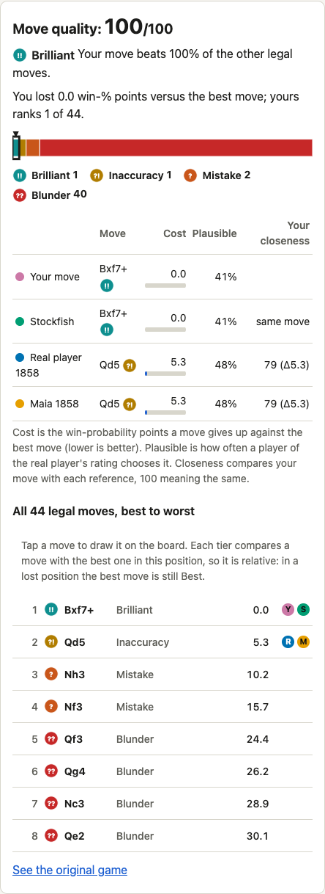
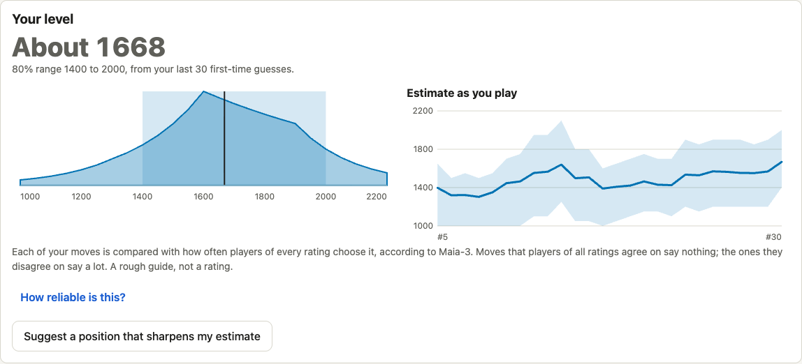
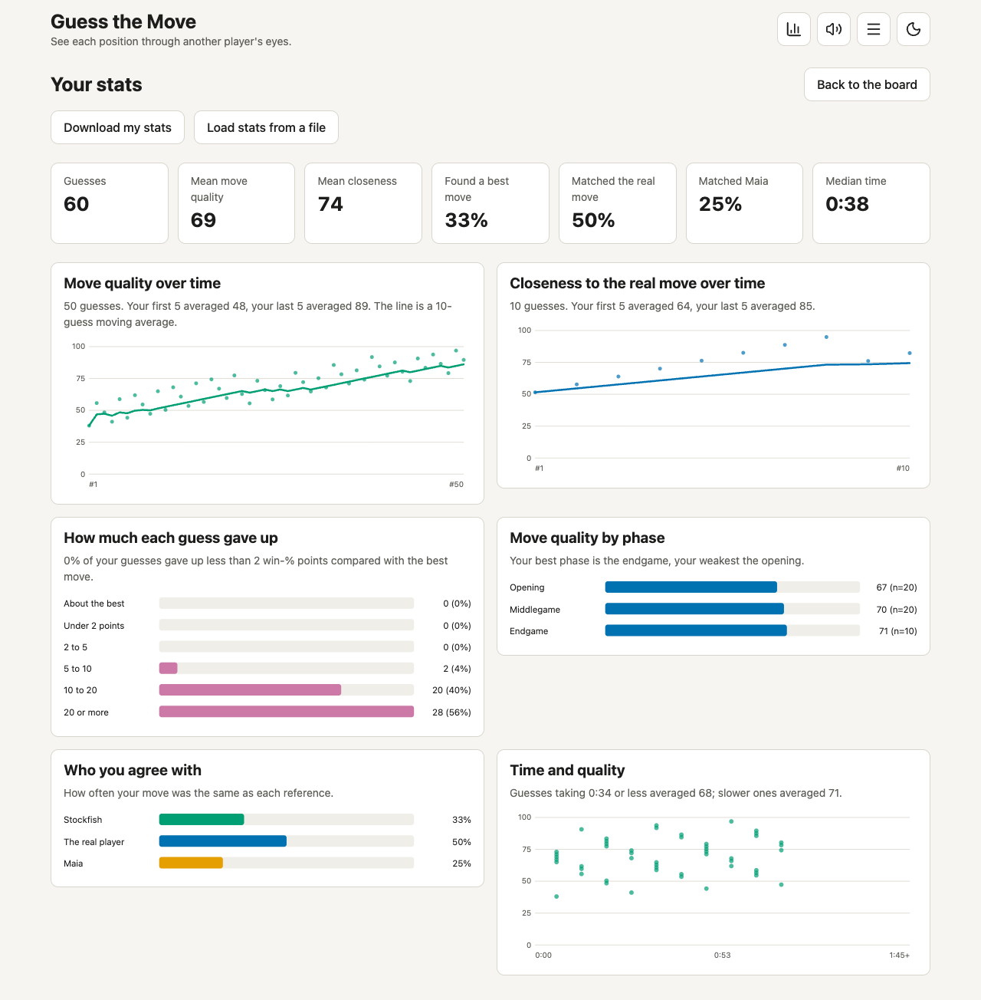
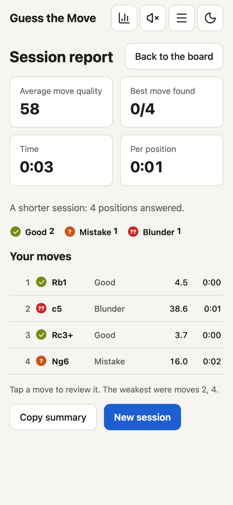

# Guess the Move

A small free-software chess trainer for learning to see a position through another player's eyes.

| The answer: tiers, the scale, every move | Your level, with its limits |
|---|---|
|  |  |

| Your stats | A session report (phone) |
|---|---|
|  |  |

You get a real position, guess a move, and the app reveals three references and how far your guess is from each, on a normalized scale:

- **Stockfish's best move** (what is objectively best),
- **the real move** played by a real player of known rating,
- **Maia's move at that rating** (what a typical player of that strength would do).

Read `PROMPT.md` for the full engineering brief (goals, decisions, scoring spec, roadmap). It is written to be pasted into an agent session.

## Run the app

```bash
python3 -m http.server -d web 8000     # then open http://localhost:8000
```

`web/data/positions.json` ships as **demo data** (three public-domain historical games, no ratings, so no Maia data). Build a real set below.

## Playing

Move a piece by **tapping it and then its destination**, by **dragging it**, or with the **keyboard** (Tab to the board, arrows move a cursor, Home jumps to the corner nearest you, Enter or Space selects and then moves, Escape cancels, `n` for the next position). Screen readers get each step announced.

A move reveals the answer and cannot be taken back, so on touch screens the app asks you to **confirm** first: a chosen move is only drawn as a pending arrow until you press "Confirm move" (change your mind by choosing another, or press Escape). That is on by default when the device reports a coarse pointer, off for a mouse, and it is a toggle in the panel (kept in `localStorage`). An undo window was considered and rejected because the reveal itself is the commit.

### Timer, sounds, stats

- **Timer** (m:ss): counts up while a position is open, pauses when you leave the tab or open a page (stats, settings, how it works, about), restarts with every position, freezes at the reveal. Each guess records its time. It can be hidden in the settings (the time is still recorded).
- **Sounds**: select, move, capture (also en passant), a chime for the best move, a neutral pair, a low tone for a poor one, plus small ticks for pages and buttons. They are synthesised in the browser (`web/sound.js`, Web Audio), no audio files. The speaker button in the top bar mutes them; the choice is remembered. Browsers only allow sound after a first click or key press, so nothing plays at load.
- **Your level** (stats page): estimated in the page from your first-time "Find the best move" guesses, with no server. Each position stores Maia-3's move probabilities at five rating anchors (`maia.by_elo`); your move is scored by how likely players of each rating are to choose it, over a rating grid, and positions where ratings disagree count for more (mutual information in bits). The page shows the estimate, an 80% range, the density and how the estimate moved as you played. **Suggest a position that sharpens my estimate**, and an optional setting, pick the most informative unseen position. It is a rough guide: on real players of known rating the 80% range held the truth about 80% of the time but was 400 to 700 points wide, estimates ran lower than Lichess Rapid ratings, and players near 1900 came out near 1650 (`docs/research/level-eval.json`; reproduce with `node tools/level_eval.js --data web/data/positions.json --interp <probe>`). Add the anchors to a dataset built without them: `.venv-maia/bin/python tools/add_anchors.py --data web/data/positions.json --pgn <the archive URL> --maia-home hf_cache` (replays each game for its history and checks it reproduces the stored Maia probabilities first); new builds with `--maia maia3` store them by default (`--maia-anchors none` to skip).
- **Settings** are a page of their own (the gear in the top bar, `#settings`): confirm, timer, retries, how positions are picked (to sharpen the level estimate, to match your level, a bit harder, or at random), daily goal, board orientation and coordinates. **Keyboard**: `?` lists every shortcut (`n` next, `p` previous, `s` skip, arrows/Enter on the board).
- **Session**: "Start a 10-position session" plays ten positions in best-move mode and ends in a report: average move quality, best moves found, time, tiers, every move (tap to review) and a summary you can copy.
- **Retry**: positions where you gave up 10 or more win-% points come back after 5, then 15, then 40 positions, until you get them right four times (at most one position in three; switch it off in the settings). The stats page shows what is due and has "Retry one now".
- **Challenges**: "Daily challenge" is five fixed positions that depend only on today's date (your local date), so everyone who plays it on the same day, with the same dataset, gets the same ones in the same order, with no server. "Challenge a friend" does the same with a random code. The report shows a Wordle-style result (one coloured square per move, by tier, plus your move quality) to copy and a link that opens the same challenge for someone else. Only your first full attempt at a challenge is recorded as its result; skipping is off. The link carries a short tag of the dataset, so a link made with another build says so instead of showing other positions.
- **Share**: the link icon next to the timer copies `…/#p=<position id>`; after the reveal, "Copy a link to my answer" copies `…/#p=<id>&m=<move>`, which opens as a review of that move for whoever you send it to (their history is not touched).
- **Save**: after the reveal, "Save image" downloads a PNG of the board with your move, the arrows, the tier and the FEN (the FEN is also stored inside the PNG); "Save FEN" and "Copy FEN" give you the position as text. All in the browser; nothing is uploaded.
- **Study again**: after you have answered a few positions, **Previous** (or `p`) reopens an earlier one in review: full answer and arrows, timer stopped at the time you took, nothing recorded twice. **Try again** replays it with the timer reset; **Next** goes forward through the reviewed ones, then suggests a new position. The trail lives in memory for this visit only (latest 100 answers).
- **Stats page** (chart icon, or `#stats`): tiles and SVG charts drawn from your history: quality over time with a moving average, closeness over time, how much each guess gave up, quality by phase, agreement with Stockfish / the real player / Maia, and time against quality. Each chart has a sentence saying what it shows.
- **Where it is stored**: `localStorage` in your browser only (keys `gtm.v1.history`, the last 500 guesses, and `gtm.v1.seen`), never sent anywhere. Clearing site data, a private window or another browser or device starts empty.
- **Download and load**: the stats page has "Download my stats" (plain JSON: `{app, format, exported, dataset, history, seen}`) and "Load stats from a file", which *merges* into what is there (a guess is identified by position and time, so loading the same file twice adds nothing) and validates every entry, since the file is untrusted input. Plain JSON rather than JSONC: any tool reads it, and comments would not survive a load.

## Tests

```bash
python3.11 -m venv .venv && .venv/bin/pip install -r requirements-dev.txt   # 3.10-3.12: maia2 (T3) does not install on 3.13+
(cd web && npm install)
make test                                          # pytest + node tests
make coverage                                      # same, plus coverage; fails below the thresholds
make mutation                                      # optional spot-check of test quality (mutmut, Stryker); not a gate
GTM_ENGINE=/opt/homebrew/bin/stockfish .venv/bin/python -m pytest -q   # + real-engine integration test
```

What is covered: maths, tags, sampler, `build_dataset.main()` end to end (a UCI stub script stands in for the engine and a fake `maia2` module for the model, so no Stockfish or torch is needed), shared Python/JS test vectors (`tests/gen_vectors.py` regenerates them; a test fails if they drift), `hypothesis` property tests, and the DOM flows in jsdom. Thresholds live in `tools/check_coverage.py` and `web/package.json` and only ratchet up. Browser tests (`make e2e`, Playwright in the installed Chrome, no browser download) cover what jsdom cannot: real pointer geometry, touch drag, scrolling, layout at 1280x800, 768x1024 and 390x844 (touch, DPR 2), axe-core, and a smoke run against a container (`GTM_BASE_URL=http://127.0.0.1:8080`). `make lighthouse` audits the running container. Third-party pieces and icons are listed in `NOTICE`.

## Installing and offline

Served from a `make dist` build over https (or localhost, e.g. `make run`), the page can be installed (browser menu, "Install app" or "Add to home screen") and opens offline: the first visit caches that build's files, later visits use the network when there is one and the cache when there is not. A new build is offered with a "Reload" bar and never replaces the page you are on by itself. Details and the caching rules are in `web/sw.js`.

## Deploying

`make dist` builds a clean static `dist/` for any web host, `make dist-check` tests it in a browser; the headers a host should send are in `docs/deploy.md`.

## Containers (rootless podman)

The app runs as podman services. Built, started and probed on 2026-11-03 on macOS (podman 5.8.2, `libkrun` machine, rootless, arm64 Linux VM; Docker Compose v5.6.1 as the compose provider; Quadlet inside the machine VM). **Not tried:** a Linux host (SELinux `:Z` behaviour, native rootless uid mapping), `podman-compose`.

```bash
make web-image && make run              # http://127.0.0.1:8080  (serves ./web/data, read-only rootfs, health check)
make stop
make dataset PGN=/in/games.pgn.zst ARGS='--min-elo 1200 --max-elo 2000 --time-controls Rapid,Classical --max-games 200000 --maia none'
                                        # PGN is a path under ./data (mounted at /in) or an http(s) URL; writes web/data/positions.json
                                        # OUT=/some/dir writes there instead (do this when you do not want to overwrite web/data)
podman compose up --build               # web only; the builder is under --profile build:
podman compose --profile build run --rm builder --help
GTM_BASE_URL=http://127.0.0.1:8080 make e2e   # the browser tests against the running container
```

Pieces: `containers/web` (nginx-unprivileged, strict CSP, `/healthz`), `containers/builder` (Python + Debian Stockfish; `WITH_MAIA=1` adds CPU torch + maia2), `compose.yaml`, `Makefile`, `deploy/quadlet/` (systemd user unit). Planned services (`api`, optional Valkey) are in `PROMPT.md` section 4.1.

What the first real runs showed (details in `PROMPT.md` 14.1):
- The web container runs as uid 101 with `--read-only --tmpfs /tmp --cap-drop=all --security-opt no-new-privileges`: nginx-unprivileged needs nothing writable beyond `/tmp`.
- The health check is passed at run time (`--health-cmd`, compose `healthcheck:`, Quadlet `HealthCmd=`), not with `HEALTHCHECK` in the Containerfile: podman builds OCI images and OCI has no such field.
- Files the builder writes to a bind mount belong to your user on the Mac (mode 600 as seen from macOS), and the nginx user in the web container reads them fine. No `--userns=keep-id` was needed.
- The builder and api images install the official Stockfish 19 release (`containers/common/install_stockfish.py`, SHA-256 checked, `/usr/local/bin/stockfish`); Debian's package was 17.1. The dataset `meta.provenance.engine` records whichever engine ran.
- Quadlet on macOS lives inside the machine VM: `podman machine ssh`, then copy the unit to `~/.config/containers/systemd/`, `systemctl --user daemon-reload && systemctl --user start guess-the-move-web`. The image must be in the VM's store (build with the normal `podman` client first).

## The api service (optional)

A small stateless HTTP JSON service (Starlette + uvicorn, Python 3.12) for what the static dataset cannot answer: **any FEN** with Stockfish and, if you give a rating, Maia; and a **level estimate** from your own guesses. It runs in its own container, is never published to the host, and the web container exposes it to the browser as `/api/`. The page feature-detects `GET /api/healthz`: with no api, nothing changes and nothing is shown.

```bash
make api-image WITH_MAIA=1      # official Stockfish 19 + CPU torch + Maia-3; without WITH_MAIA it serves engine evaluations only
make api-weights                # once: downloads the Maia-3 weights (88 MB for the 23M model, from Hugging Face) into the gtm-models volume
                                # MAIA=maia2 builds with Maia-2 instead; MAIA_MODEL=maia3-5m|maia3-79m picks another size
make run && make run-api        # web on http://127.0.0.1:8080, api on the private "gtm" network
podman compose --profile api up --build       # the same with compose; add --profile cache for Valkey
```

| Endpoint | Body | Answer |
|---|---|---|
| `GET /healthz` | | `{status, engine, maia}` |
| `POST /v1/analyse` | `{fen, elo?, opp_elo?, nodes?}` | the dataset's position object for that FEN: `evals` and `san` for every legal move, `maia` at `elo`, `phase` |
| `POST /v1/posterior` | `{history: [{fen, move, opp_elo?}], prior?}` | posterior over the 11 Maia rating buckets, mean, 80% interval, labelled "Lichess-equivalent" |

Safety: FENs are validated with python-chess (length cap, legal and reachable position, at least one legal move); body size, node budget, history length, concurrency (503 `busy`) and time per request (504) are capped; a token bucket per client (X-Forwarded-For is trusted only with `GTM_API_TRUST_PROXY=1`, which nginx sets from `$remote_addr`); cross-origin POSTs are refused and there are no CORS headers; request bodies are never logged (method, path, status and duration only). Configuration is by environment variables, listed at the top of `api/main.py`. Valkey is an optional shared cache (`VALKEY_URL`); without it, or when it is down, an in-process LRU is used and the answers are the same.

## Build a dataset

1. **Engine.** Any UCI engine works. The default is Stockfish 19 (GPL-3.0) from npm, run under Node:
   ```bash
   mkdir -p tools/engine-node && cd tools/engine-node && npm init -y && npm install stockfish
   ```
   Or use a native binary: `--engine /usr/bin/stockfish`.
2. **Games.** Use a monthly archive from https://database.lichess.org (check its licence terms before redistributing derived data; it is believed to be CC0). `--pgn` accepts a local `.pgn`/`.pgn.zst` or an `http(s)` URL, which is streamed, so with `--max-games` only the beginning of the archive is downloaded. The run prints how many games it read and exits with an error if that is zero (a truncated `.zst` otherwise ends silently).
3. **Run:**
   ```bash
   .venv/bin/python -m pipeline.build_dataset \
     --pgn lichess_db_standard_rated_2026-09.pgn.zst --out web/data/positions.json \
     --min-elo 1200 --max-elo 2000 --time-controls Rapid,Classical --max-games 200000 \
     --candidates 1500 --keep 400 --nodes 400000 --maia maia2
   ```
   Cost: about 2.5 s per position at 400k nodes on one core (every legal move is evaluated with MultiPV).
4. **Maia** (`--maia maia2`) needs `pip install maia2` (Python 3.10-3.12, pulls torch) and network access to download its weights. This path is **untested** in the environment that built v1; the pipeline fails loudly if the model returns anything other than legal UCI moves. Use `--maia none` (default) to build without human-model data.

Useful flags: `--per-game`, `--min-ply/--max-ply`, `--max-abs-cp` (drop already-decided positions), `--keep-trivial`, `--seed`, `--allow-missing-elo`.

## Continuous integration

`.github/workflows/ci.yml` (GitHub Actions) runs three jobs on every push to `main` and every pull request: Python tests with coverage, the web tests (jsdom, coverage, the click-every-position test, the browser tests in Chrome), and the container check. Each step is a `make` target, so the same thing runs on your machine first:

```bash
make ci                  # coverage, all tests, browser tests, container check: about 2 minutes here
make containers-check    # only the images: builds web, builder and api, starts web + api on a private network, probes them
```

`make ci` passes locally (2026-11-04). On GitHub (private repo, `ubuntu-24.04`) all three jobs pass (run 41683889843: 226 Python tests, 91 browser tests, the container check); getting there needed one fix to how the browser tests script a touch drag (see `PROMPT.md` 14.1). To run the workflow file itself locally you need [`act`](https://github.com/nektos/act) (not installed here), which executes the jobs in containers; the `containers` job needs podman or Docker inside that, so `make containers-check` is the faithful local check for that job. The workflow reads the code and nothing else (no secrets, read-only token), and its actions are pinned to major versions.

## Contributing and security

See `CONTRIBUTING.md` (how to run the tests, the rules the project keeps) and `SECURITY.md` (how to report a vulnerability privately). Every answer card has a "Report a problem with this position" link that opens a pre-filled issue.

## Licence

GNU Affero General Public License, version 3 or (at your option) any later version: see `LICENSE`. The reason is Maia-3, whose code and weights are AGPL-3.0: running it in the `api` service, or shipping it to browsers, is what the AGPL's network clause is about. If you run a modified version of the `api` for other people, you must offer them its source. Third-party material and its licences are in `NOTICE`. The dataset's game positions come from the Lichess open database (CC0).

## Layout

```
PROMPT.md            engineering brief (single source of truth)
CONTINUE.md          ready-to-paste prompt for the next session (needs network + podman)
compose.yaml, Makefile, containers/, deploy/quadlet/   podman packaging
pipeline/            PGN sampler, engine/Maia backends, tags, dataset builder, demo games
web/                 static app: index.html, app.js, scoring.js, style.css, data/positions.json
tests/               pytest suite + vectors.json (shared with the JS tests)
tools/engine-node/   Stockfish (npm), git-ignored
```

## Status

v1: pipeline + static app + demo data + podman packaging (images not yet built anywhere). Not yet done: real-game dataset, Maia path run for real, level estimator (see roadmap in `PROMPT.md`). Licensed AGPL-3.0-or-later (see Licence).
